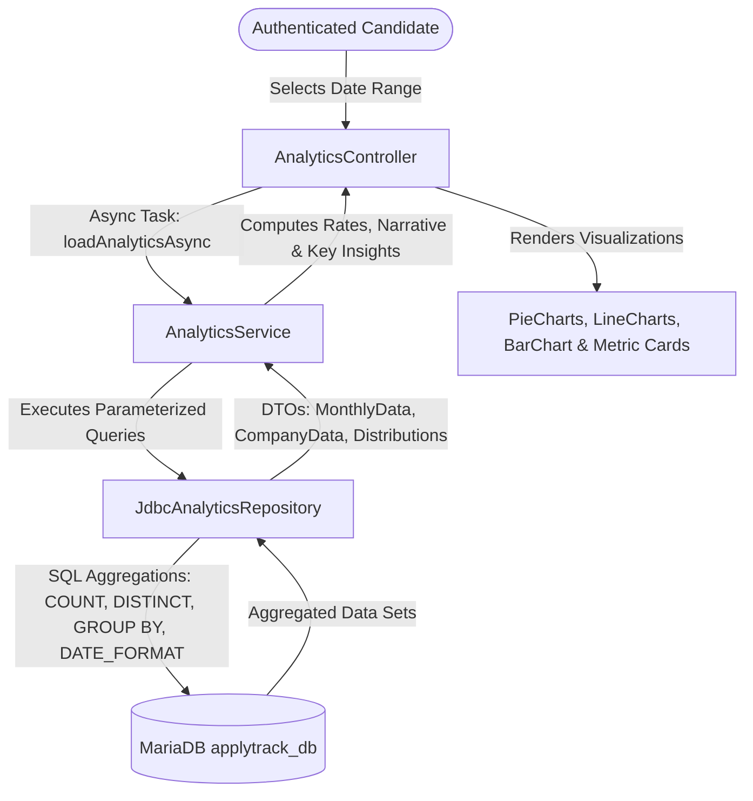
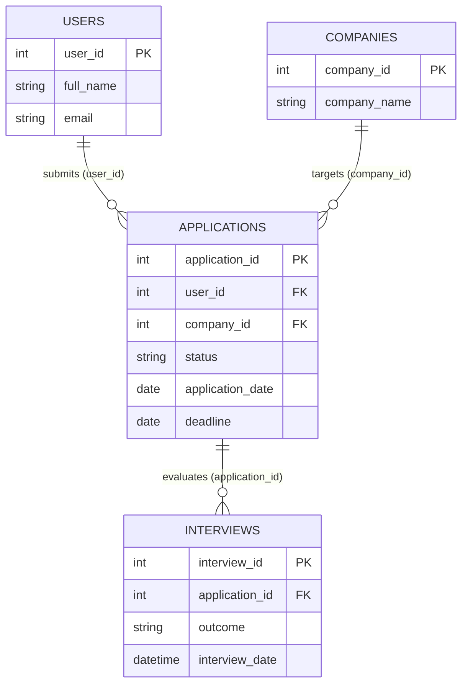

# Module 5: Advanced Career Analytics & Conversion Intelligence
## ApplyTrack — Job Application Intelligence System

---

## 1. Module Overview

The **Advanced Analytics & Insights Module** (Module 5, Phase 9) transforms raw application and interview records into actionable career intelligence. Job hunting across multiple companies is a multi-month funnel: candidates submit applications, wait for initial screening, progress through diverse technical and behavioral rounds, and aim for job offers.

ApplyTrack's Analytics Engine provides comprehensive visibility into:
1. **Pipeline Volume & Momentum:** Total applications submitted, active processes, and velocity over time.
2. **Evaluation Funnel & Conversion:** Distinct application-to-interview conversion rates and offer yields.
3. **Enterprise Targeting:** Company-wise distribution rankings.
4. **Outcome Evaluation:** Categorical breakdown of interview results (Passed, Scheduled, Failed, On Hold).
5. **Timeline Filtering:** Granular scoping across All Time, Last 30 Days, Last 3 Months, Last 6 Months, and Last 12 Months.



---

## 2. Relational Analytics Architecture

The analytics module executes high-performance SQL aggregation across four relational tables (`users`, `applications`, `interviews`, `companies`) without altering database tables or constraints:



---

## 3. Core Metrics & Mathematical Formulations

Every metric displayed on the dashboard is derived dynamically from real database records:

### 1. Total Applications ($N_{total}$)
Total applications submitted by the logged-in user within the selected timeframe:
$$\text{Total Applications} = \text{COUNT}(*) \quad \text{WHERE } user\_id = ? \text{ AND } application\_date \ge \text{startDate}$$

### 2. Active Applications ($N_{active}$)
Applications in non-terminal, ongoing review states (`Applied`, `Under Review`, `Shortlisted`, `Interview Scheduled`):
$$\text{Active Applications} = \text{COUNT}(*) \quad \text{WHERE } status \in \{\text{'Applied'}, \text{'Under Review'}, \text{'Shortlisted'}, \text{'Interview Scheduled'}\}$$

### 3. Offers Received ($N_{offers}$)
Applications culminating in successful selection or offer (`status = 'Selected'`).

### 4. Rejected Applications ($N_{rejected}$)
Applications marked as screened out or unsuccessful (`status = 'Rejected'`).

### 5. Interview Conversion Rate ($R_{interview}$)
The percentage of submitted job applications that successfully yield at least one interview round:
$$R_{interview} = \begin{cases} 
\left( \frac{\text{Distinct Applications with } \ge 1 \text{ Interview Round}}{\text{Total Applications}} \right) \times 100 & \text{if } N_{total} > 0 \\ 
0.0\% & \text{if } N_{total} = 0 
\end{cases}$$

> [!IMPORTANT]
> **Distinct Application Safeguard:** An application featuring multiple rounds (e.g. Google with Round 1 OA, Round 2 Tech, Round 3 System Design) is counted as **exactly one interviewed application** in the conversion numerator via `COUNT(DISTINCT a.application_id)`. This prevents multi-round processes from artificially inflating the conversion rate beyond 100%.

### 6. Offer Rate ($R_{offer}$)
The proportion of total applications that result in job/internship offers:
$$R_{offer} = \begin{cases} 
\left( \frac{N_{offers}}{N_{total}} \right) \times 100 & \text{if } N_{total} > 0 \\ 
0.0\% & \text{if } N_{total} = 0 
\end{cases}$$

---

## 4. Visualizations & Chart Design

| Visualization | JavaFX Component | Dimension / Grouping | Technical Implementation |
| :--- | :--- | :--- | :--- |
| **Status Distribution** | `PieChart` | `applications.status` | Grouped by status, slices color-coded with `ApplicationStatus.getBadgeColor()`. |
| **Monthly Application Trajectory** | `LineChart<String, Number>` | `DATE_FORMAT(application_date, '%Y-%m')` | Chronological multi-year timeline with year-month grouping (e.g. `Oct 2025` vs `Oct 2026`). |
| **Interview Outcome Breakdown** | `PieChart` | `interviews.outcome` | Categorical slices (`Passed`, `Scheduled`, `Failed`, `On Hold`) mapped to `InterviewOutcome` colors. |
| **Monthly Interview Trajectory** | `LineChart<String, Number>` | `DATE_FORMAT(interview_date, '%Y-%m')` | Chronological volume of interview rounds conducted or scheduled per month. |
| **Top Target Companies** | `BarChart<String, Number>` | `companies.company_name` | Top 10 organizations ranked descending by application count via SQL `LIMIT 10`. |

---

## 5. Multi-Tenant Security & Isolation Model

ApplyTrack supports multi-user environments. To enforce complete data confidentiality:

1. **Session-Driven Identity:** User identity is always resolved through `UserSession.getInstance().getUserId()`. The UI never accepts user IDs from client requests or URL parameters.
2. **Parameterized Scoping:** Every SQL query binds `user_id = ?` as its primary filter:
   ```sql
   SELECT c.company_name, COUNT(a.application_id) AS app_count
   FROM applications a
   JOIN companies c ON a.company_id = c.company_id
   WHERE a.user_id = ? AND a.application_date >= ?
   GROUP BY c.company_name ORDER BY app_count DESC LIMIT 10
   ```
3. **Indirect Interview Isolation:** Interviews do not contain a direct `user_id` column; they are securely joined through `applications a ON i.application_id = a.application_id WHERE a.user_id = ?`.
4. **Verified Zero-Leakage:** Automated tests verify that querying analytics for an unpopulated user ID returns zero counts, empty lists, and empty maps without leaking records from other users.

---

## 6. Date Range Filtering Engine

The `DateRangeFilter` enum provides dynamic, testable temporal boundaries:

| Filter Option | Start Date Calculation | Application Scope | Interview Scope |
| :--- | :--- | :--- | :--- |
| **All Time** | `null` (No lower bound) | Entire history | Entire history |
| **Last 30 Days** | `LocalDate.now().minusDays(30)` | `application_date >= ?` | `interview_date >= ?` |
| **Last 3 Months** | `LocalDate.now().minusMonths(3)` | `application_date >= ?` | `interview_date >= ?` |
| **Last 6 Months** | `LocalDate.now().minusMonths(6)` | `application_date >= ?` | `interview_date >= ?` |
| **Last 12 Months** | `LocalDate.now().minusMonths(12)` | `application_date >= ?` | `interview_date >= ?` |

All charts, KPI metric cards, and insights dynamically update in unison upon changing the dropdown selection or clicking **"↻ Refresh"**.

---

## 7. Performance & Concurrency Architecture

1. **SQL-Level Aggregation:** Calculations utilize SQL server-side functions (`COUNT`, `DISTINCT`, `GROUP BY`, `DATE_FORMAT`) rather than pulling thousands of raw entity rows into Java heap memory.
2. **Asynchronous Multithreading:** The database aggregation is offloaded to a background daemon worker via `javafx.concurrent.Task<AnalyticsSummary>`.
3. **UI Thread Safety:** When the background task completes, UI cards and charts are populated via `task.setOnSucceeded` on the JavaFX Application Thread.
4. **Loading States:** An interactive `ProgressIndicator` overlay provides visual feedback during computation.

---

## 8. College Java Syllabus Alignment

### Unit 1: Java Fundamentals
- **Modern Date/Time:** `LocalDate`, `YearMonth`, and `DateTimeFormatter` parsing and formatting date strings.
- **Safe Arithmetic:** Safeguards preventing divide-by-zero exceptions in percentage formulas.
- **Enhanced Switch:** Exhaustive switch expressions in `DateRangeFilter.getStartDate()`.

### Unit 2: Methods, Strings, Arrays, Classes & Objects
- **DTO Design Pattern:** Encapsulation in `AnalyticsSummary`, `MonthlyApplicationData`, `CompanyApplicationData`, and `KeyInsights`.
- **Comparable Interface:** `Comparable<MonthlyApplicationData>` and `Comparable<CompanyApplicationData>` powering chronological timelines and company rankings.
- **Method Overloading:** `AnalyticsService` constructors facilitating mock repository injection for automated testing.

### Unit 3: Object-Oriented Programming and Advanced Java
- **Interface Abstraction:** Loose coupling between `AnalyticsService` and `AnalyticsRepository`.
- **JDBC & PreparedStatement:** Parameterized SQL queries preventing injection attacks and ensuring multi-tenant scoping.
- **Collections Framework:** `Map<String, Integer>`, `LinkedHashMap`, `ObservableList`, `List<MonthlyApplicationData>`, and Java Stream API.
- **Concurrency & Multithreading:** Asynchronous execution with `javafx.concurrent.Task` to ensure 60 FPS JavaFX rendering.
- **JavaFX Visual Controls:** Integration of `PieChart`, `LineChart`, `BarChart`, `CategoryAxis`, and `NumberAxis`.

---

## 9. Verification & Automated Test Suite

Module 5 is validated through **30 automated tests** (15 unit tests + 15 live database integration tests):

- **`com.applytrack.service.AnalyticsServiceTest` (15 Unit Tests):**
  - Rate calculations (normal, zero applications, zero interviewed, rounding).
  - Status distribution enrichment with percentages and badge colors.
  - Key insights generation with realistic and empty datasets.
  - Multi-year chronological sorting for `MonthlyApplicationData`.
  - Company ranking comparisons for `CompanyApplicationData`.
  - DateRangeFilter calculations across 30 days, 3 months, 6 months, 12 months.
  - Null repository constructor validation.
- **`com.applytrack.repository.JdbcAnalyticsRepositoryLiveTest` (15 Live MariaDB Tests):**
  - Live counts for total, active, offer, and rejected applications for demo user.
  - Live interview counts and distinct application conversion checks.
  - Upcoming interview counts.
  - Status and outcome distributions.
  - Multi-year monthly grouping and chronological ordering.
  - Company grouping with descending order and limit constraints.
  - Date-range query filtering.
  - User-specific isolation verification for non-existent users (0 records).
  - Cross-user data leakage prevention between two distinct database accounts.

- **Entire Project Automated Suite:** **208 automated tests** passing across 29 test classes with 0 failures and 0 errors.

