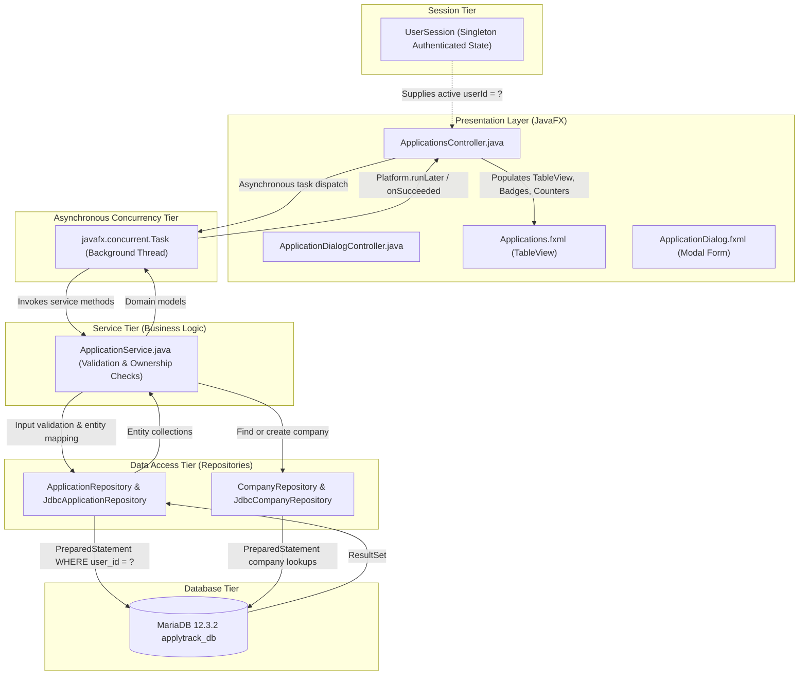

# ApplyTrack — Job Application Management Module (Phase 6)

## 1. Overview & Vision

The **Job Application Management Module** (Module 2) is the core operational engine of **ApplyTrack – Job Application Intelligence System**. It provides students and job seekers with complete CRUD (Create, Read, Update, Delete) control over their job and internship applications through a clean, modern SaaS desktop interface powered by JavaFX and backed by MariaDB.

---

## 2. Architecture & Layered Design

ApplyTrack enforces strict separation of concerns across presentation, business logic, and database persistence:



---

## 3. Component Responsibilities

### 1. `ApplicationsController.java`
- Manages the primary applications screen (`Applications.fxml`).
- Renders the interactive JavaFX `TableView<Application>`.
- Configures custom `TableCell` renderers for colored status badges (`ApplicationStatus`), deadline countdowns with urgency highlighting (`ChronoUnit.DAYS`), formatted dates, and currency formatting (`NumberFormat.getCurrencyInstance`).
- Provides real-time search listening (`searchField.textProperty()`), status dropdown filtering (`statusFilterBox`), job type filtering (`jobTypeFilterBox`), and dynamic sorting (`sortByBox`).
- Dispatches database queries asynchronously using `javafx.concurrent.Task` to ensure the UI stays responsive at 60 FPS without freezing.
- Manages row selection state, enabling/disabling action buttons ("View Details", "Edit Application", "Delete Application").
- Handles double-clicks on table rows to instantly open application details.

### 2. `ApplicationDialogController.java`
- Manages the modal application creation and editing form (`ApplicationDialog.fxml`).
- Dynamically switches title between **"Add New Job Application"** and **"Edit Job Application"**.
- Populates form dropdowns using Java Enums (`JobType.values()`, `ApplicationStatus.values()`).
- Validates numeric salary parsing and surfaces descriptive error banners without closing the dialog if input validation fails.
- Resolves companies transparently through `ApplicationService`.

### 3. `ApplicationService.java`
- Enforces strict input validation and business rules:
  - Company name is required and non-blank.
  - Job role is required and non-blank.
  - Application date is required.
  - Deadline cannot be earlier than application date.
  - Expected salary cannot be negative.
  - Job posting URL must be a valid HTTP/HTTPS address if supplied.
- Enforces **Ownership Verification**: Before executing any update or delete operation, verifies that the application ID belongs to the currently logged-in user (`userId`), throwing a `ValidationException` otherwise.
- Coordinates automatic company resolution via `CompanyRepository.findOrCreateByName()`, avoiding duplicate company records.

### 4. `ApplicationRepository.java` & `JdbcApplicationRepository.java`
- Implements standard data access routines using `PreparedStatement` with parameterized placeholders (`?`) to prevent SQL injection.
- Retrieves generated primary keys on insert using `Statement.RETURN_GENERATED_KEYS`.
- Joins the `applications` table with the `companies` table to populate full company details (`company_name`, `website`, `industry`, `location`).
- Implements whitelisted dynamic sorting to prevent SQL injection through `ORDER BY` clauses.

### 5. `CompanyRepository.java` & `JdbcCompanyRepository.java`
- Handles company lookups by primary key and case-insensitive name matching (`findByName`).
- Implements `findOrCreateByName(String companyName)`: returns the existing company if present, or creates a new row and returns its generated ID.

---

## 4. User-Specific Data Security

> [!IMPORTANT]
> **Strict Multi-Tenant Isolation Rule:**
> Every application in ApplyTrack belongs strictly to the authenticated user. A user can never view, search, edit, or delete another user's applications.

1. **Session Enforcement:** The controller retrieves the active user ID strictly from `UserSession.getInstance().getUserId()`.
2. **Double-Barreled Query Protection:**
   - Every `SELECT` query includes `WHERE a.user_id = ?`.
   - Every `UPDATE` query includes `WHERE application_id = ? AND user_id = ?`.
   - Every `DELETE` query includes `WHERE application_id = ? AND user_id = ?`.
3. **Service Ownership Verification:** `ApplicationService.updateApplication()` and `deleteApplication()` query `findById(id, userId)` before executing any write operation. If the application is not owned by the user, the operation is blocked with:
   `"Application not found or you do not have permission to modify it."`
4. **Integration Tested:** Verified by `JdbcApplicationRepositoryLiveTest` and `ApplicationServiceTest`. Even if an adversary user tampers with the application object in memory, the database update returns `0` rows affected, guaranteeing complete data security.

---

## 5. Search, Filter, and Dynamic Sorting

### Search
- Matches partial text against both `companies.company_name` and `applications.job_role`.
- Implemented using SQL parameterized `LIKE`:
  ```sql
  AND (LOWER(c.company_name) LIKE ? OR LOWER(a.job_role) LIKE ?)
  ```
  Where parameters are bound with `"%\" + keyword.toLowerCase().trim() + \"%\"`.

### Status & Job Type Filtering
- Dropdown options:
  - **Statuses:** All Statuses, Applied, Under Review, Shortlisted, Interview Scheduled, Selected, Rejected, Withdrawn, No Response.
  - **Job Types:** All Types, Full-time, Internship, Part-time.
- Query bindings:
  ```sql
  AND a.status = ? AND a.job_type = ?
  ```

### Whitelisted Dynamic Sorting
To completely prevent SQL injection through sort column names, the repository maps user-selected sort options against an explicit switch whitelist:
- `"Application Date (Newest)"` -> `ORDER BY a.application_date DESC, a.application_id DESC`
- `"Application Date (Oldest)"` -> `ORDER BY a.application_date ASC, a.application_id DESC`
- `"Deadline (Nearest)"` -> `ORDER BY a.deadline IS NULL, a.deadline ASC, a.application_id DESC`
- `"Company Name (A-Z)"` -> `ORDER BY c.company_name ASC, a.application_id DESC`
- `"Company Name (Z-A)"` -> `ORDER BY c.company_name DESC, a.application_id DESC`
- `"Job Role (A-Z)"` -> `ORDER BY a.job_role ASC, a.application_id DESC`

---

## 6. CRUD Operations Lifecycle

| Operation | User Action | Service / Repository Method | SQL Query |
| :--- | :--- | :--- | :--- |
| **Create** | Click "+ Add Application" -> Complete form -> "Save" | `ApplicationService.createApplication()` -> `JdbcApplicationRepository.save()` | `INSERT INTO applications (...) VALUES (?, ?, ...)` |
| **Read (List)** | Open Applications view or change search/filter | `ApplicationService.getFilteredApplications()` -> `JdbcApplicationRepository.findWithFilters()` | `SELECT a.*, c.* FROM applications a JOIN companies c ON ... WHERE a.user_id = ? ...` |
| **Read (Details)** | Double-click row or click "View Details" | Read selected application properties or `findById()` | Populates detailed summary alert with salary, URL, notes, and dates |
| **Update** | Click "Edit Application" -> Modify form -> "Update" | `ApplicationService.updateApplication()` -> `JdbcApplicationRepository.update()` | `UPDATE applications SET ... WHERE application_id = ? AND user_id = ?` |
| **Delete** | Click "Delete Application" -> Confirm dialog | `ApplicationService.deleteApplication()` -> `JdbcApplicationRepository.delete()` | `DELETE FROM applications WHERE application_id = ? AND user_id = ?` |

---

## 7. Foreign Key Cascade & Database Integrity

Per `database/schema.sql`:
- Deleting an application automatically cascades to child interview rounds:
  ```sql
  CONSTRAINT fk_interview_app FOREIGN KEY (application_id)
      REFERENCES applications(application_id) ON DELETE CASCADE ON UPDATE CASCADE
  ```
- Deleting a company is restricted if active applications reference it (`ON DELETE RESTRICT`), preventing accidental data loss.
- Deleting a recruiter safely sets `recruiter_id` to `NULL` (`ON DELETE SET NULL`), preserving the core application record.

---

## 8. Dashboard Live Sync Integration

- When an application is created, edited, or deleted in the Applications module, navigating back to the **Dashboard** automatically triggers `dashboardController.refreshDashboardData()`.
- The dashboard retrieves fresh counts from MariaDB:
  - Total Applied counter updates.
  - In Progress counter updates.
  - Status Distribution `PieChart` updates.
  - Monthly Application Velocity `LineChart` updates.
  - Upcoming Deadlines list updates.

