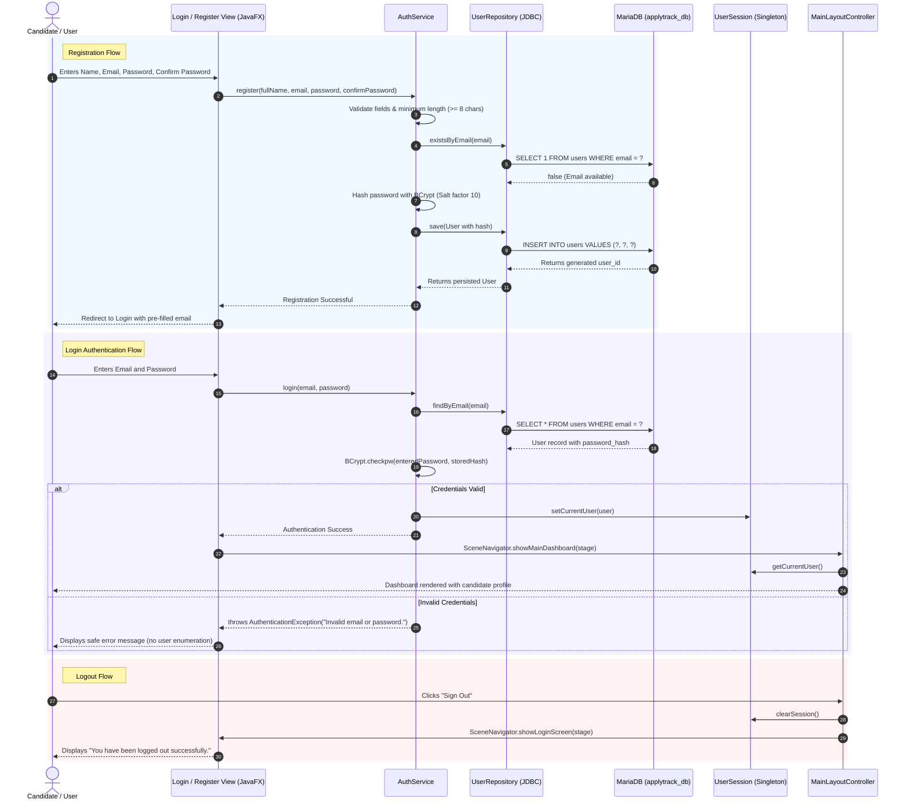

# ApplyTrack – Authentication & Security Architecture

> **Designed for College Hackathons & Second-Year Computer Science Curriculum.**  
> Explains the secure authentication flow, layered responsibilities, BCrypt password hashing, session tracking, and security best practices.

---

## 1. Authentication Architecture & Sequence Diagram

The following Mermaid sequence diagram illustrates the complete user lifecycle from registration to authenticated dashboard access and logout:



---

## 2. Layered Responsibilities

| Layer | Component | Core Responsibility |
| :--- | :--- | :--- |
| **Presentation (View / Controller)** | `LoginController`, `RegisterController` | Captures UI inputs, provides show/hide password toggle, displays error/success feedback, and triggers scene changes. |
| **Business Logic (Service)** | `AuthService` | Enforces domain rules (minimum 8 characters, matching confirmation), hashes passwords via BCrypt, and verifies credentials. |
| **Persistence (Repository)** | `UserRepository`, `JdbcUserRepository` | Prepares parameterized SQL statements (`PreparedStatement`), handles `SQLException`, and retrieves auto-generated keys. |
| **Session Management** | `UserSession` | Thread-safe Singleton holding the authenticated `User` object for downstream modules. |
| **Domain Model** | `User` | Encapsulates candidate identity without exposing the password hash in logs (`[PROTECTED]`). |

---

## 3. BCrypt Password Hashing Explained

In basic student projects, passwords are often saved in plain text or using outdated algorithms like MD5 or SHA-1, which are vulnerable to lookup tables and rainbow table attacks.

ApplyTrack uses **BCrypt** (`org.mindrot:jbcrypt`):
1. **Adaptive Work Factor (Salt Factor):** BCrypt incorporates a random 128-bit salt and an exponential cost parameter (set to factor 10, performing $2^{10} = 1024$ key expansion rounds).
2. **One-Way Salting:** Each hash has a unique salt embedded:
   ```
   $2a$10$n3HO5YCqxZO.xV/6h6bOW.fWUBql4Qdn0bJv9nR2z5b0LtyrMEtbK
   \__/ \/ \____________________/\_____________________________/
    |    |            |                            |
  Prefix Cost     22-char Salt              31-char Hash
   ```
3. **Verification Without Decryption:** `BCrypt.checkpw(plainText, storedHash)` extracts the salt from the stored hash, hashes the candidate's plain-text input using that exact salt, and compares the resulting hashes.

---

## 4. Key Security Practices Implemented

1. **Defense Against SQL Injection:** All database operations strictly use `java.sql.PreparedStatement` with bind parameters (`?`). No string concatenation is used in queries.
2. **Prevention of Username Enumeration:** During login failure, `AuthService` throws a uniform message: `"Invalid email or password."`. It never reveals whether the email exists.
3. **Password Masking in Logs:** `User.toString()` and `DatabaseConfig.toString()` conceal sensitive strings as `[PROTECTED]` and `******`.
4. **Session Cleansing on Logout:** Calling `UserSession.clearSession()` zeroes out user references, preventing session lingering.
5. **No Password Stored in Memory:** `UserSession` maintains the entity reference with the hash, never storing plain-text passwords.

