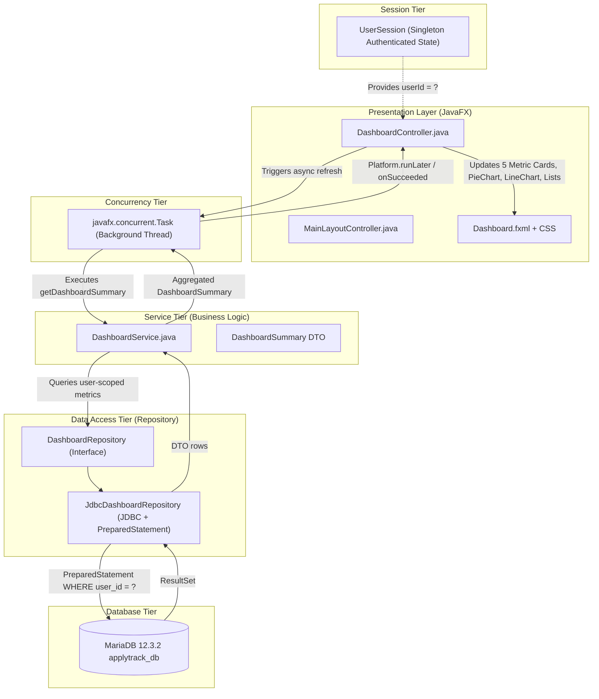

# ApplyTrack — Dashboard Architecture & Design (Phase 5)

## 1. Overview & Vision

The **ApplyTrack Dynamic Dashboard** is the command center of the Job Application Intelligence System. Rather than presenting hardcoded or static mock numbers, the dashboard connects directly to MariaDB via JDBC to compute real-time, user-specific analytics, pipeline metrics, visual distribution charts, deadline cutoffs, and upcoming interview schedules.

---

## 2. Architecture & Layered Design

ApplyTrack strictly adheres to **Separation of Concerns** across four dedicated architectural tiers:



---

## 3. Component Responsibilities

### 1. `DashboardController.java`
- Manages JavaFX controls and view events.
- Formats dates using modern `java.time.LocalDate` and `DateTimeFormatter`.
- Offloads database querying to a background daemon thread via `javafx.concurrent.Task` to ensure the desktop UI remains responsive (60 FPS) and never freezes.
- Populates the 5 metric cards, `PieChart` (status breakdown), `LineChart` (monthly trend velocity), upcoming deadlines container, and scheduled interviews list.
- Implements empty states when a user has no applications or activities.

### 2. `DashboardService.java`
- Coordinates business logic and data aggregation.
- Injects `DashboardRepository` via constructor dependency injection (enabling mock testing).
- Formats date keys (e.g. converting `"2026-10"` into `"Oct 2026"` using `YearMonth` and `Locale.US`).
- Computes overall offer conversion rates (`getOfferRate()`).
- Returns an immutable, null-safe `DashboardSummary` DTO.

### 3. `DashboardRepository.java` & `JdbcDashboardRepository.java`
- Interface contract defining strictly scoped query methods.
- Implements JDBC interactions using `PreparedStatement` with parameterized placeholders (`?`) to prevent SQL injection vulnerabilities.
- Manages connection lifecycle with robust `try-with-resources`.

### 4. DTOs in `com.applytrack.model.dto`
- `DashboardSummary`: Container for metric counts, distribution maps, and activity lists.
- `DeadlineSummaryItem`: Encapsulates application cutoff details, computes remaining days via `ChronoUnit.DAYS`, and assigns visual urgency badges.
- `InterviewSummaryItem`: Encapsulates multi-round interview schedules, interview modes, and meeting URLs.

---

## 4. User-Specific Data Security

> [!IMPORTANT]
> **Strict Multi-Tenant Isolation Rule:**
> In ApplyTrack, every single application query MUST be filtered by the authenticated applicant's ID (`WHERE user_id = ?`). A user can never view another applicant's applications, interviews, or analytics.

When the dashboard loads or refreshes:
1. `UserSession.getInstance().getUserId()` retrieves the active session ID.
2. If `userId <= 0` (unauthenticated or guest), data loading is bypassed and an empty state is presented.
3. Every SQL query in `JdbcDashboardRepository` binds `stmt.setInt(1, userId)` as its primary filter condition.

---

## 5. SQL Query Logic & Metric Definitions

### 1. Metric Cards

| Metric Card | Metric Definition | Executed SQL Query |
| :--- | :--- | :--- |
| **Total Applied** | All-time applications submitted by the user. | `SELECT COUNT(*) FROM applications WHERE user_id = ?` |
| **In Progress** | Applications currently under active evaluation (`'Applied'`, `'Under Review'`, `'Shortlisted'`, `'Interview Scheduled'`). Excludes terminal states (`Selected`, `Rejected`, `Withdrawn`). | `SELECT COUNT(*) FROM applications WHERE user_id = ? AND status IN ('Applied', 'Under Review', 'Shortlisted', 'Interview Scheduled')` |
| **Interviews** | Scheduled interview rounds associated with user's applications. | `SELECT COUNT(i.interview_id) FROM interviews i JOIN applications a ON i.application_id = a.application_id WHERE a.user_id = ? AND i.outcome = 'Scheduled'` |
| **Offers** | Applications resulting in job or internship offers (`'Selected'`). | `SELECT COUNT(*) FROM applications WHERE user_id = ? AND status = 'Selected'` |
| **Rejected** | Applications archived as rejected. | `SELECT COUNT(*) FROM applications WHERE user_id = ? AND status = 'Rejected'` |

---

### 2. Status Distribution (PieChart)

Groups applications across pipeline states:
```sql
SELECT status, COUNT(*) AS count_val
FROM applications
WHERE user_id = ?
GROUP BY status
ORDER BY count_val DESC;
```
JavaFX `PieChart` renders each status with slice labels showing `Status (Count)`.

---

### 3. Monthly Application Velocity (LineChart)

Groups applications chronologically by month of submission:
```sql
SELECT DATE_FORMAT(application_date, '%Y-%m') AS month_key, COUNT(*) AS count_val
FROM applications
WHERE user_id = ?
GROUP BY DATE_FORMAT(application_date, '%Y-%m')
ORDER BY month_key ASC;
```
The Service layer transforms `"2026-09"` to `"Sep 2026"`, `"2026-10"` to `"Oct 2026"`, and `"2026-11"` to `"Nov 2026"`.

---

### 4. Upcoming Deadlines Calculation & Urgency

Retrieves active applications whose deadline has not expired:
```sql
SELECT a.application_id, c.company_name, a.job_role, a.deadline, a.status,
       DATEDIFF(a.deadline, CURRENT_DATE) AS days_remaining
FROM applications a
JOIN companies c ON a.company_id = c.company_id
WHERE a.user_id = ?
  AND a.deadline IS NOT NULL
  AND a.deadline >= CURRENT_DATE
  AND a.status NOT IN ('Selected', 'Rejected', 'Withdrawn')
ORDER BY a.deadline ASC
LIMIT 5;
```

**Urgency Tagging Rules (`DeadlineSummaryItem.Urgency`):**
- `OVERDUE` (`daysRemaining < 0`): Red badge
- `URGENT_3_DAYS` (`0 <= daysRemaining <= 3`): Danger red pill badge
- `SOON_7_DAYS` (`4 <= daysRemaining <= 7`): Warning amber pill badge
- `UPCOMING` (`daysRemaining > 7`): Info blue pill badge

---

### 5. Scheduled Interviews Retrieval

Joins interviews, applications, and companies:
```sql
SELECT i.interview_id, a.application_id, c.company_name, a.job_role,
       i.round_name, i.interview_date, i.interview_mode, i.meeting_link,
       i.interviewer_name, i.outcome
FROM interviews i
JOIN applications a ON i.application_id = a.application_id
JOIN companies c ON a.company_id = c.company_id
WHERE a.user_id = ?
  AND (i.outcome = 'Scheduled' OR i.interview_date >= NOW())
ORDER BY i.interview_date ASC
LIMIT 5;
```
Rendered as interactive rows displaying company, round, date, time (IST), mode, and meeting links.

---

## 6. Asynchronous Refresh Mechanism

To prevent UI latency or network pauses from freezing the JavaFX window:
1. User clicks the **"↻ Refresh"** button (or navigates to the Dashboard from the sidebar).
2. The refresh button is temporarily disabled to prevent duplicate concurrent submissions.
3. A `javafx.concurrent.Task<DashboardSummary>` is dispatched on a background daemon thread (`ApplyTrack-DashboardWorker`).
4. Upon successful completion, JavaFX automatically invokes `task.setOnSucceeded` on the JavaFX Application Thread.
5. The UI controls and charts are safely updated, and the timestamp label shows: `Last synchronized: HH:mm:ss`.
6. If a database error occurs, `task.setOnFailed` captures the exception and displays an informative error badge without crashing.

---

## 7. Verification & Test Suite Summary

- **`DashboardSummaryTest`**: Tests DTO immutability, conversion rates, and urgency classifications.
- **`DashboardServiceTest`**: In-memory unit tests validating calculation accuracy, empty states, and month formatting.
- **`DashboardRefreshTest`**: Verifies dynamic data refresh and cache invalidation.
- **`JdbcDashboardRepositoryLiveTest`**: Live MariaDB integration tests verifying that Demo User 1 (`Alex Mercer`) retrieves all real seed records, while Stranger User 99999 retrieves 0 records.

