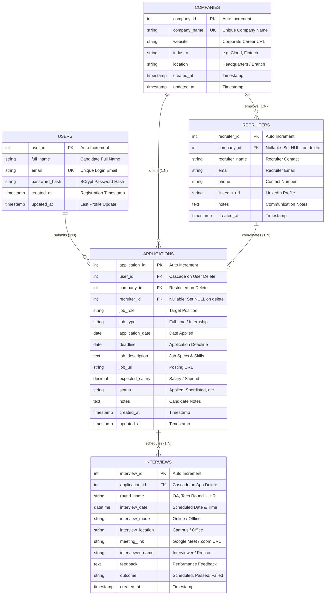

# ApplyTrack – Relational Database Design Documentation

This document provides a comprehensive architectural explanation of the relational database designed for **ApplyTrack – Job Application Intelligence System**.

---

## 1. Entity-Relationship (ER) Diagram

The following diagram illustrates the 5 core tables, their attributes, keys, and relational cardinality:

---

## 2. Table-by-Table Architectural Specification

### Table 1: `users`
- **Purpose:** Stores applicant account credentials and personal profile information. Supports authentication in Phase 4.
- **Primary Key:** `user_id` (Auto-incrementing integer).
- **Unique Constraint:** `email` ensures no duplicate registrations.
- **Security:** `password_hash` stores salted BCrypt hashes generated using `org.mindrot:jbcrypt`. Plain-text passwords are never stored.

### Table 2: `companies`
- **Purpose:** Stores the employers and organizations the user applies to.
- **Primary Key:** `company_id`.
- **Unique Constraint:** `company_name` prevents duplicate company profiles.
- **Fields:** `website`, `industry`, `location`.

### Table 3: `recruiters`
- **Purpose:** Maintains a professional contact directory of campus recruiters, talent partners, and engineering hiring managers.
- **Primary Key:** `recruiter_id`.
- **Foreign Key:** `company_id` referencing `companies(company_id)`.
  - **Referential Action:** `ON DELETE SET NULL`. If a company is ever removed, the recruiter's contact information remains intact without breaking historical references.

### Table 4: `applications`
- **Purpose:** The core tracking table linking candidates, employers, application deadlines, and statuses.
- **Primary Key:** `application_id`.
- **Foreign Keys:**
  1. `user_id` $\rightarrow$ `users(user_id)` with `ON DELETE CASCADE`.
  2. `company_id` $\rightarrow$ `companies(company_id)` with `ON DELETE RESTRICT`. A company cannot be deleted if active applications exist for it, protecting against accidental data loss.
  3. `recruiter_id` $\rightarrow$ `recruiters(recruiter_id)` with `ON DELETE SET NULL`. Deleting a recruiter contact does not destroy the application record.
- **Key Attributes:**
  - `status`: Tracks lifecycle (`Applied`, `Under Review`, `Shortlisted`, `Interview Scheduled`, `Selected`, `Rejected`, `Withdrawn`, `No Response`).
  - `deadline`: Monitored by the upcoming reminders service and priority queue.
  - `expected_salary`: Stored as `DECIMAL(12, 2)` to avoid floating-point rounding errors.

### Table 5: `interviews`
- **Purpose:** Tracks sequential rounds of evaluation (Online Assessments, Technical Coding rounds, System Design, HR interviews) for a single job application.
- **Primary Key:** `interview_id`.
- **Foreign Key:** `application_id` $\rightarrow$ `applications(application_id)` with `ON DELETE CASCADE`. If an application is deleted, its child interview rounds are automatically removed.
- **Key Attributes:**
  - `interview_date`: Full `DATETIME` used for chronological reminders and timeline displays.
  - `interview_mode`: Differentiates between `Online` and `Offline`.
  - `outcome`: `Scheduled`, `Passed`, `Failed`, `Cancelled`, `Pending`.

---

## 3. Referential Integrity & Delete Cascade Strategy

A common flaw in beginner projects is using `ON DELETE CASCADE` everywhere, which can accidentally wipe out entire databases when a single related row is deleted. In ApplyTrack:

1. **Safe Parent-Child Relationships:**
   - Deleting an `application` cascades to its `interviews` (because an interview round belongs solely to that specific job application).
2. **Protected Master Entities:**
   - Deleting a `company` is **RESTRICTED** if job applications exist. The user must explicitly reassign or delete the applications first.
3. **Preserved Contact Relationships:**
   - Deleting a `company` or `recruiter` sets foreign keys to `NULL` (`ON DELETE SET NULL`) rather than wiping out the associated applications.

---

## 4. Query Performance & Indexing

To guarantee fast dashboard loading and real-time conversion rate calculations as records grow:

- `idx_apps_status`: Accelerates filtering by application status and calculating the conversion funnel.
- `idx_apps_date`: Optimizes monthly application trend queries.
- `idx_apps_deadline`: Optimizes upcoming deadline queries (<3 days, <7 days).
- `idx_apps_role`: Enables instant substring searches on job roles.
- `idx_interviews_date`: Speeds up upcoming interview scheduling queries.
- `idx_interviews_outcome`: Accelerates interview pass/fail calculations.

---

## 5. JDBC Implementation Standards

1. **PreparedStatement Only:** All queries and updates must use `java.sql.PreparedStatement` to prevent SQL injection vulnerabilities.
2. **Try-With-Resources:** Every `Connection`, `PreparedStatement`, and `ResultSet` is enclosed in try-with-resources blocks to eliminate database connection leaks.
3. **No Stored Shared Connections:** ApplyTrack uses a connection provider factory (`DatabaseConnection.getConnection()`) rather than keeping a single shared connection open indefinitely.

