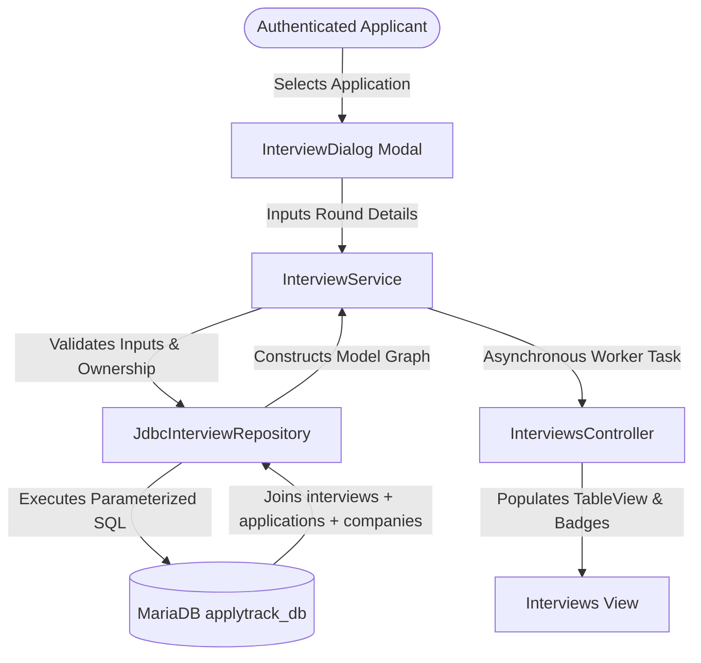
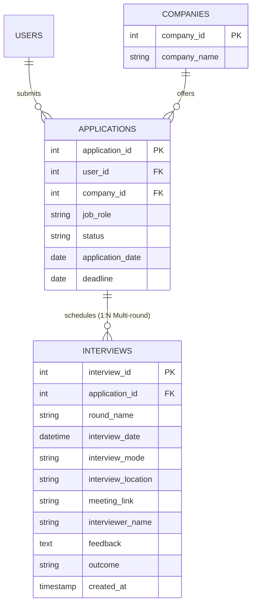

# Module 3: Interview Pipeline Management
## ApplyTrack — Job Application Intelligence System

---

## 1. Module Overview

The **Interview Pipeline Management Module** (Module 3, Phase 7) empowers applicants to track every evaluation stage of their hiring processes. Job applications frequently involve multiple sequential evaluation stages—such as Online Assessments (OA), technical screening rounds, system design interviews, and behavioral or HR rounds. 

ApplyTrack's Interview Pipeline connects directly to the user's active job applications, enabling multi-round tracking, real-time schedule management, video conferencing link storage, interviewer contact recording, and detailed feedback documentation.



---

## 2. Multi-Round Relational Architecture

The relational model links each interview round directly to a parent job application via foreign key constraints with `ON DELETE CASCADE`.



### Relational Features:
- **1-to-Many Relationship:** A single job application (e.g. Google SDE) can have multiple interview rounds (`Round 1: OA`, `Round 2: Technical Interview`, `Round 3: System Design`).
- **Cascade Deletion:** Removing an application automatically purges all associated interview rounds from the database, preventing orphaned records.
- **Normalized Data Structure:** Applications reference the central `companies` table, avoiding redundant company name copies.

---

## 3. Multi-Tenant Data Security & Isolation

The `interviews` table does not store a direct `user_id` column; it is linked to the authenticated candidate through `application_id -> applications.user_id`.

To prevent cross-tenant data leaks and unauthorized modifications:

1. **Scheduling Security Check:**
   ```java
   Optional<Application> appOpt = applicationRepository.findById(applicationId, userId);
   if (appOpt.isEmpty()) {
       throw new ValidationException("Job application not found or does not belong to the authenticated user.");
   }
   ```
2. **Query Scoping:** Every SQL `SELECT` joins with `applications` and applies a strict `WHERE a.user_id = ?` clause:
   ```sql
   SELECT i.*, a.user_id, c.company_name
   FROM interviews i
   JOIN applications a ON i.application_id = a.application_id
   JOIN companies c ON a.company_id = c.company_id
   WHERE a.user_id = ?
   ```
3. **Update & Delete Isolation:** Updates and deletions verify ownership by scoping to both the primary key and user ID:
   ```sql
   DELETE i FROM interviews i
   JOIN applications a ON i.application_id = a.application_id
   WHERE i.interview_id = ? AND a.user_id = ?
   ```

---

## 4. Key Capabilities & User Experience

| Feature | Description |
| :--- | :--- |
| **Multi-Round Tracking** | Schedule infinite evaluation rounds per application with distinct dates and interviewers. |
| **Online & In-Person Modes** | Support for `Online` (with clickable video links) and `Offline` (with physical building/room locations). |
| **Outcome Pipeline** | State transitions: `Scheduled` ➔ `Pending` ➔ `Passed` / `Failed` / `On Hold` / `Cancelled`. |
| **Real-Time Live Search** | Instant keyword filtering matching company name, job role, round title, interviewer name, and feedback notes. |
| **Timeline Filters** | Quick filtering by `All Interviews`, `Upcoming Interviews` (future + Scheduled), and `Completed / Past`. |
| **Outcome Badges** | Dynamic, color-coded pill badges matching the SaaS palette for visual status distinction. |
| **Cross-Module Launch** | Directly schedule interviews from the **Job Applications** table for the selected position. |
| **Dashboard Synchronization** | Live sync with the executive dashboard's upcoming interview panel and counters. |

---

## 5. College Syllabus Alignment

### Unit 1: Java Fundamentals
- **Data Types & Modern Date/Time:** Utilization of `LocalDateTime`, `LocalDate`, `LocalTime`, and `DateTimeFormatter`.
- **String Parsing & Regex:** Flexible multi-format time parser supporting 12-hour AM/PM and 24-hour military formats (`^\\d:\\d{2}$`).
- **Enhanced Switch Statements:** Pattern matching and expression switch for whitelisted sorting and navigation routing.

### Unit 2: Object-Oriented Programming & Core APIs
- **Inheritance:** `Interview` extends `BaseEntity` to inherit common primary keys (`id`) and timestamp auditing (`createdAt`, `updatedAt`).
- **Polymorphism & Interfaces:** `Interview` implements `Searchable`, enabling unified polymorphic search mechanisms.
- **Java Enums with Rich Metadata:** `InterviewMode` and `InterviewOutcome` encapsulate custom display names and hex badge colors.
- **Encapsulation & Defensive Design:** Strict validation on round names, date constraints, and URL validation via `ValidationUtil`.

### Unit 3: Advanced Architecture, Collections & Concurrency
- **Collections Framework:** Heavy usage of `List<Interview>`, `ObservableList<Interview>`, and Java Stream API (`filter`, `sorted`, `map`, `toList`).
- **JDBC Persistence:** Parameterized queries via `PreparedStatement`, transaction safety, and auto-generated key retrieval (`Statement.RETURN_GENERATED_KEYS`).
- **Asynchronous Multithreading:** Background data loading using `javafx.concurrent.Task<List<Interview>>` to keep UI buttery smooth without freezing the JavaFX Application Thread.
- **Layered Separation of Concerns:** Strict architectural boundary: UI Controller ➔ Service ➔ Repository ➔ MariaDB.

---

## 6. Verification and Test Suite

The module is verified through 28 specialized automated test cases (17 unit tests + 11 live integration tests):

- `com.applytrack.service.InterviewServiceTest`:
  - 17 unit tests validating scheduling, field checks, null handling, URL parsing, cross-tenant security isolation, updates, and count algorithms.
- `com.applytrack.repository.JdbcInterviewRepositoryLiveTest`:
  - 11 live MariaDB integration tests validating multi-table joins, primary key generation, multi-round retrieval, cascade deletion, search, and isolation against actual database tables.

