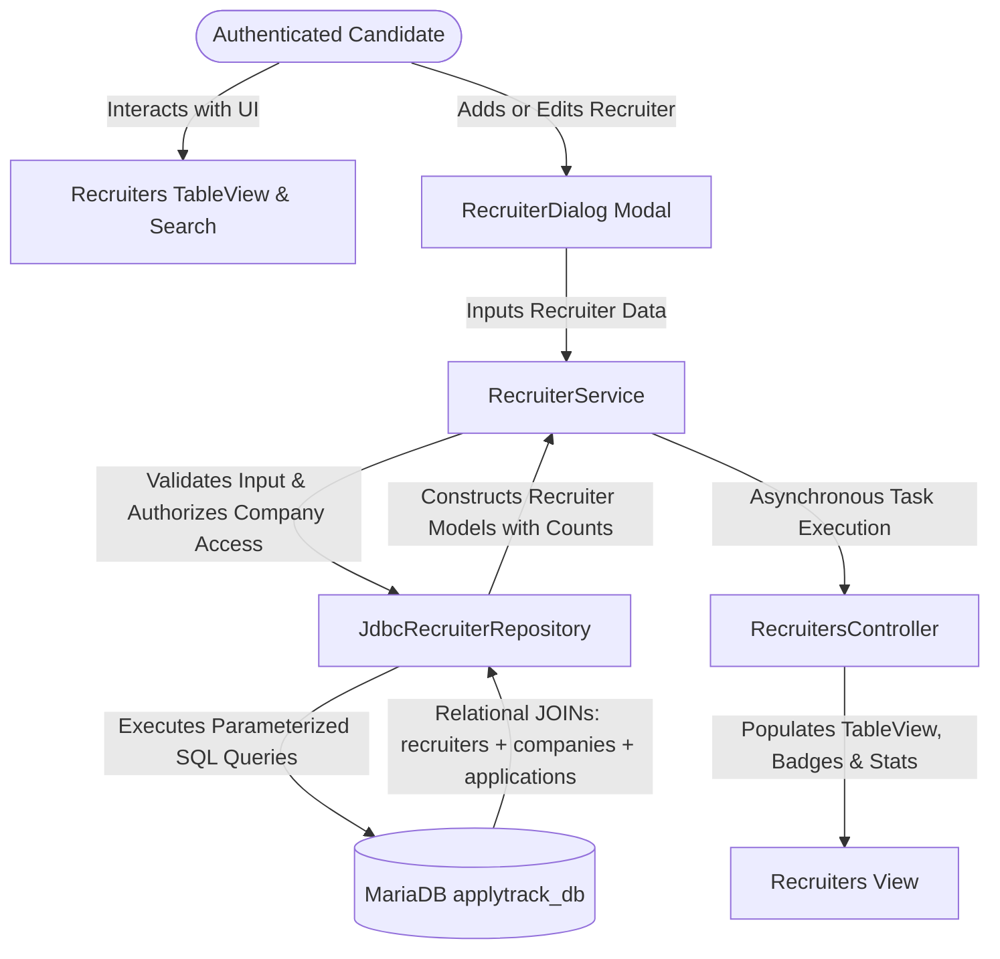
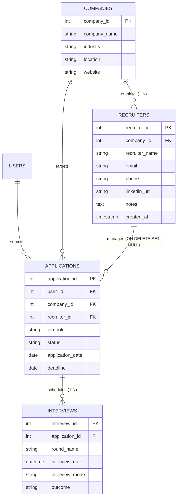
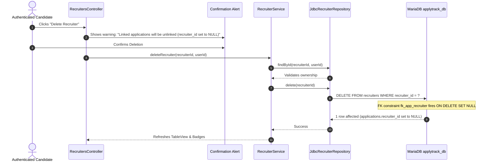

# Module 4: Recruiter Directory & Relationship Management
## ApplyTrack — Job Application Intelligence System

---

## 1. Module Overview

The **Recruiter Directory & Relationship Management Module** (Module 4, Phase 8) enables job seekers to systematically record, manage, and track recruiter relationships throughout their hiring pipelines. In professional job hunting, applicants frequently engage with technical recruiters, hiring managers, sourcers, and talent acquisition partners across multiple target companies. 

ApplyTrack's Recruiter Management module links recruiters directly to their respective companies and candidate applications, providing instant visibility into communication channels, contact information (email, phone, LinkedIn), personal notes, and associated application pipelines.



---

## 2. Relational Architecture & Entity-Relationship Design

The relational database architecture links recruiters to companies via foreign key constraints, while associating candidates to recruiters through the `applications` pipeline.



### Relational Design Highlights:
- **Foreign Key to Companies:** `company_id` references `companies(company_id)` with `ON DELETE SET NULL ON UPDATE CASCADE`.
- **Application Linkage:** `applications.recruiter_id` references `recruiters(recruiter_id)` with `ON DELETE SET NULL ON UPDATE CASCADE`.
- **Referential Integrity:** Deleting a recruiter automatically sets `recruiter_id = NULL` on linked applications, safeguarding candidate applications and interview history from accidental cascading deletion.

---

## 3. Multi-Tenant Indirect Ownership & Data Security

In corporate HR platforms and job-hunting ecosystems, recruiters belong to companies rather than individual users. The `recruiters` table does not feature a direct `user_id` column; instead, ownership and accessibility are established **indirectly** through the candidate's active job application pipeline.

### 1. Indirect Ownership Isolation
A recruiter is visible and manageable to an authenticated user (`userId`) if and only if:
1. The candidate has an active application directly assigned to that recruiter:
   `a.recruiter_id = r.recruiter_id AND a.user_id = ?`
2. OR the recruiter belongs to a company where the candidate has applied:
   `r.company_id = a.company_id AND a.user_id = ?`

```sql
SELECT r.*, c.company_name,
       COUNT(DISTINCT a.application_id) AS associated_apps_count
FROM recruiters r
LEFT JOIN companies c ON r.company_id = c.company_id
JOIN applications a ON (a.recruiter_id = r.recruiter_id OR a.company_id = r.company_id)
WHERE a.user_id = ?
GROUP BY r.recruiter_id, c.company_name
```

### 2. Company Association Authorization
To prevent candidates from associating recruiters with arbitrary or unauthorized companies, `RecruiterService` enforces an authorization check:

```java
if (companyId != null && !recruiterRepository.isCompanyAccessibleToUser(companyId, userId)) {
    throw new ValidationException(
        "Cannot associate recruiter with a company that is not part of your active job application pipeline."
    );
}
```

`isCompanyAccessibleToUser` executes a parameterized validation query:
```sql
SELECT COUNT(*) FROM applications WHERE company_id = ? AND user_id = ?
```

### 3. Mutation Authorization Checks
Before updating or deleting any recruiter record, `RecruiterService` executes an explicit ownership verification:
```java
Optional<Recruiter> existingOpt = recruiterRepository.findById(recruiterId, userId);
if (existingOpt.isEmpty()) {
    throw new ValidationException("Recruiter not found or you are not authorized to modify this contact.");
}
```

---

## 4. Foreign Key Lifecycle & Referential Integrity

A critical architectural consideration in recruiter management is the **foreign key lifecycle**. When a recruiter leaves an agency or is deleted by the candidate, what happens to the linked job applications?



### Database Schema Constraint:
```sql
CONSTRAINT fk_app_recruiter 
    FOREIGN KEY (recruiter_id) 
    REFERENCES recruiters(recruiter_id) 
    ON DELETE SET NULL 
    ON UPDATE CASCADE
```
- **Preservation of Core Records:** Applications, application deadlines, interview history, and notes remain 100% intact.
- **Transparent UX:** The UI explicitly notifies the candidate that deleting the recruiter will safely unlink them without destroying application progress.

---

## 5. Key Capabilities & User Experience

| Capability | Technical Description | User Experience Benefit |
| :--- | :--- | :--- |
| **Comprehensive Contact Directory** | Captures name, email, phone, LinkedIn URL, associated company, and interview notes. | Centralizes all networking contacts in one structured repository. |
| **Real-Time Live Search** | Filter-as-you-type matching recruiter name, email, company name, and notes. | Instant contact discovery without page reloading. |
| **Company Filtering** | Dropdown filter populated with target companies present in the user's pipeline. | Enables company-focused recruiter engagement tracking. |
| **Dynamic Application Counters** | Aggregated `COUNT(DISTINCT a.application_id)` displayed as custom colored pill badges. | Instant visual feedback on recruiter engagement depth. |
| **Recruiter Details Inspection** | Double-click or "View Details" popup revealing full contact info, linked applications, and scheduled interview rounds. | Complete 360-degree context before reaching out or attending an interview. |
| **Cross-Module Application Integration** | Add/Edit Application dialog features an optional Recruiter ComboBox scoped to the candidate's directory. | Seamless linkage between job applications and contact persons. |
| **Asynchronous Multithreading** | Background loading via `javafx.concurrent.Task<List<Recruiter>>`. | Maintains responsive 60 FPS JavaFX rendering with loading spinners. |

---

## 6. Academic Syllabus Alignment

### Unit 1: Java Fundamentals
- **Data Types & References:** Primitive `int` IDs and modern Java reference types (`String`, `Integer`, `Recruiter`, `Company`).
- **Regular Expressions & Validation:** Email syntax (`^[A-Za-z0-9+_.-]+@(.+)$`), phone number validation, and LinkedIn URL formatting (`ValidationUtil`).
- **Enhanced Switch Statements:** Dynamic column sorting with compile-time exhaustiveness checking.
- **Conditional Branching:** Granular validation checks (`if-else` guard clauses) verifying nullability and length limits.

### Unit 2: Methods, Strings, Arrays, Classes & Objects
- **Encapsulation:** Private domain fields in `Recruiter.java` with defensive getters, setters, and formatted helper methods (`getFormattedApplicationsCount()`).
- **Inheritance:** `Recruiter` extends `BaseEntity` to inherit common primary keys (`id`) and timestamp auditing (`createdAt`, `updatedAt`).
- **Polymorphism & Interfaces:** `Recruiter` implements `Searchable`, enabling unified polymorphic search mechanisms (`matches(query)`).
- **StringBuilder Query Construction:** Dynamic, parameterized SQL query generation with conditional `WHERE` filters and sorting clauses.
- **Method Overloading:** Overloaded constructors and service methods supporting optional parameters and test stubs.

### Unit 3: Object-Oriented Programming and Advanced Java
- **Interface-Driven Architecture:** Decoupled contract `RecruiterRepository` implemented by `JdbcRecruiterRepository`.
- **JDBC & Transaction Safety:** Parameterized `PreparedStatement`, `Statement.RETURN_GENERATED_KEYS`, and automatic resource management via `try-with-resources`.
- **Multi-Tenant Security Enforcement:** Rigorous SQL scoping preventing cross-user data leakage.
- **Asynchronous Concurrency:** JavaFX multithreading with `javafx.concurrent.Task` to offload database I/O from the JavaFX Application Thread.
- **Collections Framework & Stream API:** Use of `ObservableList<Recruiter>`, `List<Recruiter>`, and stream operations (`filter`, `sorted`, `map`, `toList`).
- **Custom Exception Handling:** Checked domain exceptions (`ValidationException`, `SQLException`) with user-friendly alert banners.

---

## 7. Verification & Test Suite

The module is verified through **28 automated test cases** (18 unit tests + 10 live integration tests):

- **`com.applytrack.service.RecruiterServiceTest` (18 Unit Tests):**
  1. `testCreateRecruiterSuccess`: Validates normal recruiter creation with company linkage.
  2. `testCreateRecruiterWithoutCompany`: Validates creation of independent/agency recruiters.
  3. `testCreateRecruiterEmptyNameThrowsValidationException`: Validates required name rule.
  4. `testCreateRecruiterInvalidEmailThrowsValidationException`: Validates email regex.
  5. `testCreateRecruiterInvalidPhoneThrowsValidationException`: Validates phone format.
  6. `testCreateRecruiterInvalidLinkedInUrlThrowsValidationException`: Validates LinkedIn URL format.
  7. `testCreateRecruiterInaccessibleCompanyThrowsValidationException`: Validates company security sandbox.
  8. `testFindRecruiterByIdSuccess`: Validates authorized lookup.
  9. `testFindRecruiterByIdNotFoundOrUnauthorizedReturnsEmpty`: Validates unauthorized lookup isolation.
  10. `testUpdateRecruiterSuccess`: Validates field updates.
  11. `testUpdateRecruiterUnauthorizedThrowsValidationException`: Validates update ownership check.
  12. `testDeleteRecruiterSuccess`: Validates deletion workflow.
  13. `testDeleteRecruiterUnauthorizedThrowsValidationException`: Validates delete ownership check.
  14. `testGetRecruitersByUser`: Validates candidate list retrieval.
  15. `testGetRecruitersByCompany`: Validates company filtering.
  16. `testSearchRecruiters`: Validates multi-attribute keyword matching.
  17. `testGetAssociatedApplications`: Validates retrieval of linked applications.
  18. `testGetAssociatedInterviews`: Validates retrieval of linked interview rounds.

- **`com.applytrack.repository.JdbcRecruiterRepositoryLiveTest` (10 Live MariaDB Integration Tests):**
  1. `testCreateAndFindById`: Verifies auto-generated keys and table joins.
  2. `testFindAllByUser`: Verifies user-scoped retrieval with application counts.
  3. `testFindByCompany`: Verifies company-filtered queries.
  4. `testSearchByKeyword`: Verifies SQL `LIKE %keyword%` matching across name, email, company, notes.
  5. `testUpdateRecruiter`: Verifies database mutations and timestamp updates.
  6. `testDeleteRecruiterAndVerifySetNullCascade`: Verifies `ON DELETE SET NULL` foreign key behavior.
  7. `testCountByUser`: Verifies aggregate counting query.
  8. `testIsCompanyAccessibleToUser`: Verifies candidate pipeline company validation.
  9. `testGetAssociatedApplications`: Verifies linked application retrieval for modal details.
  10. `testGetAssociatedInterviews`: Verifies linked interview round retrieval.

- **Entire Project Test Suite:** **178 automated tests** passing across 27 test classes with 0 failures and 0 errors.

